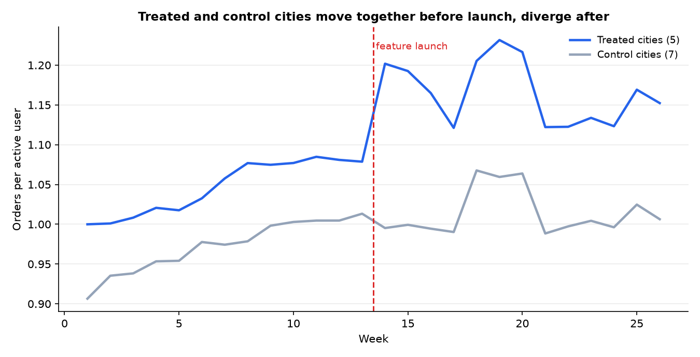
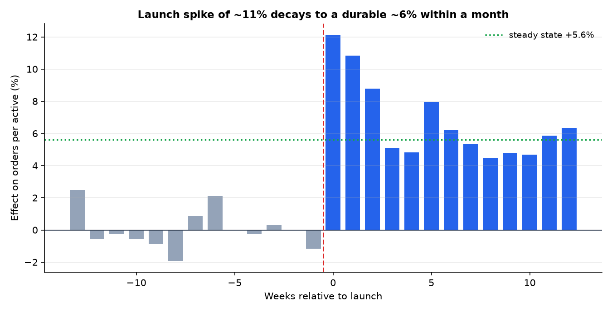
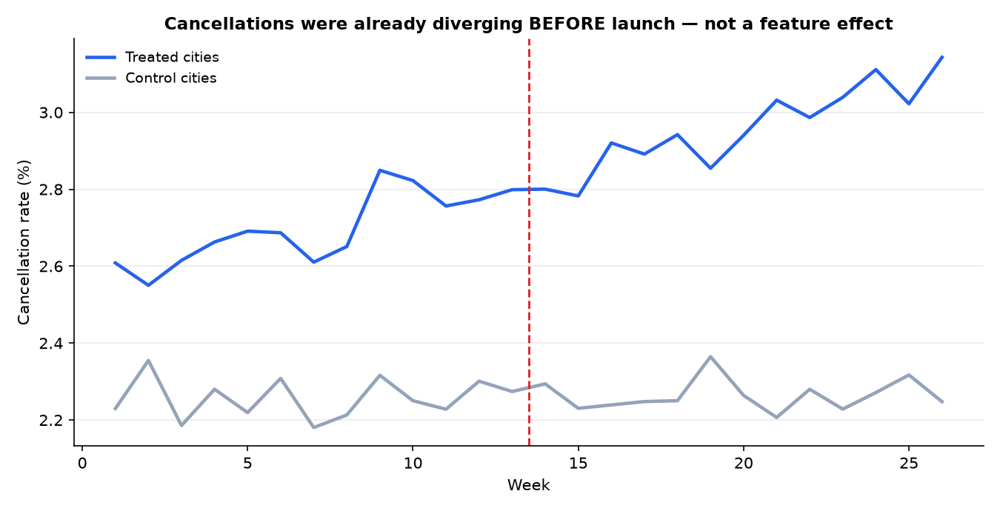

# Did "Reorder in 1 Tap" actually work?

**Measuring feature impact when you can't run an A/B test.**
Difference-in-differences on a staggered city rollout · `Python (pandas, NumPy, SciPy, matplotlib)`

> **Data disclaimer:** all data is simulated. "QuickKart" is a fictional
> quick-commerce app; no real company's data is used or implied. Effects are
> injected deliberately so the analysis can be scored against a known answer.

---

## The problem

A quick-commerce app shipped a one-tap reorder feature to **5 of its 12 cities**
in week 14. No randomised test — engineering rolled out city by city.
Leadership wants to know: *did it work, and should we ship it everywhere?*

Orders in those cities rose **+11.4%** after launch. That number is wrong.
Cities that never received the feature also grew, because of seasonality and
underlying growth. This project separates the feature's effect from everything
that would have happened anyway.

## The answer

| | |
|---|---|
| **Effect on orders per active user** | **+5.6%** (95% CI +4.1% to +7.2%), p = 0.001 |
| Naive before/after | +11.4% — roughly **2× overstated** |
| Effect on GMV per active | **+3.4%** — because AOV fell 2.1% |
| Launch fortnight vs steady state | +11.5% → +5.6% (novelty decay) |
| Who benefits | power users +9.5%, regular +7.7%, new users ~0 |
| Guardrails | tickets flat; cancellations **not attributable** (failed pre-trends) |

**Recommendation: roll out — but forecast on +5.6%, track GMV not orders, and
don't expect it to activate new users.** Full reasoning in
[`docs/decision_memo.md`](docs/decision_memo.md).

## What the analysis shows



The two groups move together before week 14 — which is what licenses the method
— then separate.



The launch fortnight shows +11.5%; it settles near +5.6% within a month. This is
why the launch-week dashboard number should never become the forecast.



Cancellations rose in the treated cities — but they were **already** rising
before launch. This one gets flagged as a capacity problem, not reported as a
feature effect. Knowing when to refuse to answer is part of the analysis.

## Method

```
1. Adoption check        did anyone use it? (27.7% of orders)
2. Naive pre/post        the wrong answer, quantified (+11.4%)
3. Parallel trends       city-level pre-slopes + event study  <- the licence to use DiD
4. DiD estimate          (treated after - before) - (control after - before)
5. Inference             exact randomization test over all 792 assignments
                         + cluster bootstrap CI (resampling whole cities)
6. Event study           novelty vs durable effect
7. Guardrails            AOV, conversion, cancellations, support tickets
8. Heterogeneity         user-level DiD by segment, with CIs
9. Placebo               fake launch on pre-period data (+0.5% ✓)
```

With only 12 cities, cluster-robust standard errors would be unreliable — so
significance comes from an **exact randomisation test** across every possible
5-city assignment, and the confidence interval from a **cluster bootstrap**.
Reasoning in [`docs/methodology.md`](docs/methodology.md).

## Repo map

```
data/
  generate_panel_data.py     seeded simulator; documents every injected effect
  output/*.csv               312-row city-week panel + 48k-row user table
analysis/
  run_analysis.py            full pipeline; prints every number, saves all charts
notebooks/
  feature_impact_analysis.ipynb   the same analysis as a teaching notebook (Colab-ready)
docs/
  decision_memo.md           the product deliverable — one page, a recommendation
  methodology.md             DiD, assumptions, inference with few clusters, limitations
  code_walkthrough.md        every code block explained in plain English
  interview_qa.md            20 questions on causal inference
  resume_bullets.md
```

## Run it

**In Google Colab (no setup):** open
`notebooks/feature_impact_analysis.ipynb`, set your GitHub username in the data-
loading cell, and run all.

**Locally:**
```bash
pip install -r requirements.txt
python data/generate_panel_data.py     # optional; CSVs are committed
python analysis/run_analysis.py        # prints every number, writes docs/img/
```
The dataset is seeded, so every figure in the docs reproduces exactly.

## What this project demonstrates

- **Causal inference in practice** — DiD, parallel-trends testing, event
  studies, placebo tests, randomisation inference, cluster bootstrap.
- **Knowing when not to answer** — the cancellation metric fails its assumption
  check and is deliberately left unattributed.
- **Product judgment over statistics** — the orders lift is real but oversells
  the feature; the durable number differs from the launch number; the average
  hides that new users get nothing.
- **Communication** — a one-page memo with a recommendation and named risks,
  not a notebook dump.

## Related

- **Blinkit-style Product Growth & Marketplace Health Analytics** — T-SQL,
  cohorts, funnels, RFM, ops health.
- **Promotion Framing Optimization** — A/B testing and segmentation, the
  randomised counterpart to this quasi-experimental project.

---
*Portfolio project for Product/Data Analyst roles. Data simulated; method real.*
